# Job Autopilot

<sub>Built by <a href="https://www.linkedin.com/in/manasnikte">Manas Nikte</a> · made for F-1 students in America ·
<a href="https://github.com/ManasNikte">GitHub</a> · <a href="mailto:nikte.m@northeastern.edu">Email</a> ·
<a href="https://www.linkedin.com/in/manasnikte">LinkedIn</a></sub>

**A local, AI-powered job-application pipeline.** Twice a day it finds new US roles at companies that
sponsor H-1B visas. Claude screens each posting against your own "master prompt" (your background plus
your rules). For the good matches it writes a tailored one-page resume and cover letter, rendered straight
to PDF and checked automatically. A Chrome extension fills the application form, and you press Submit.
Anything that needs your judgment lands in one **Needs you** inbox, and **replies from employers are read from
your inbox** to keep every application's status current.

Everything runs on your own machine at `http://127.0.0.1:5055`. Nothing is hosted. It runs on **macOS, Windows,
and Linux**, and **[one command](CLAUDE_SETUP.md) lets Claude Code set it all up for you**.

> 🌐 **Your online dashboard (phone, tablet, TV): [manasnikte.github.io/job-autopilot](https://manasnikte.github.io/job-autopilot/)**.
> Lost the link? It's always here and in the **Website** link at the top of this repo page. Your account is created
> on your own computer during setup (**Settings → Online dashboard**), so on the site you just sign in.

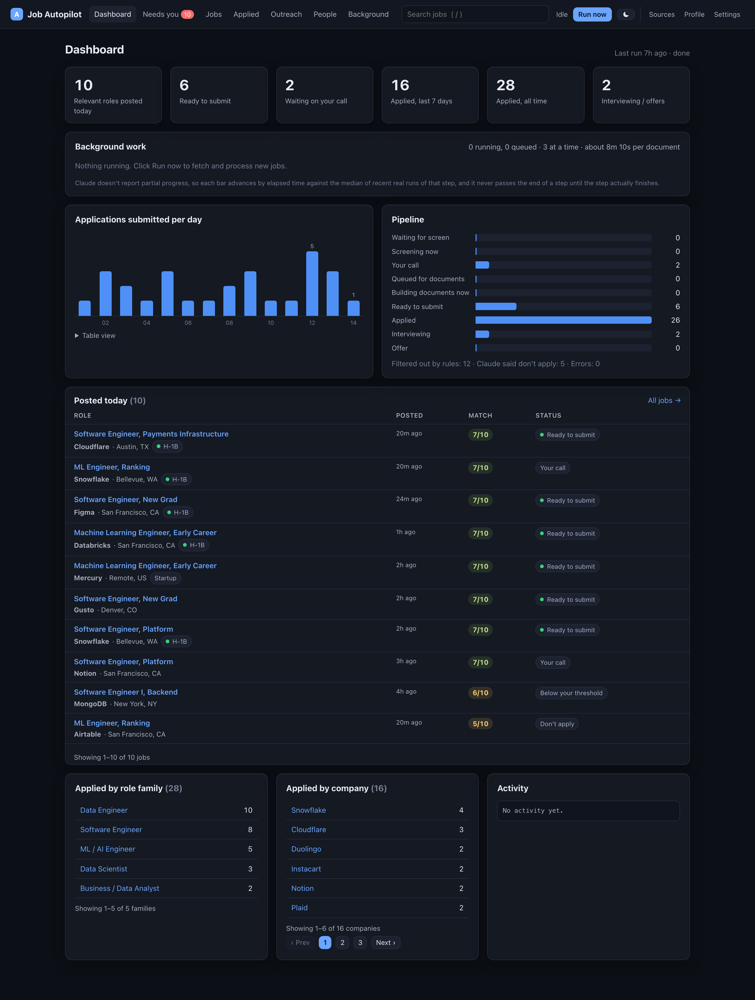

> 📄 **[Project report](PROJECT_REPORT.md)**: the problem, how it works overnight, time saved, architecture, and lessons learned.
>
> Screenshots use the built-in demo data (`scripts/demo_seed.py`). The candidate, "Jordan Lee", is fictional.

---

## 🆕 What's new

**v3.6–v3.10: a reorganized app that runs itself.**

- **Sidebar navigation with search.**
  - Every page and sub-page sits in one compact list: job filters, email filters, profile files, and six separate
    Settings pages.
  - **Search the app** (⌘K) to jump to a page or a single setting, such as "minimum pay", "Claude usage", or "Gmail".
  - The arrows above Overview slide the sidebar to an icon rail. In a narrow window it becomes a drawer.
- **A weekly view of your progress.**
  - Applications for each day, Sunday to Saturday, with the number on top of every day. Pick any past week.
  - A **Time saved** estimate: the author's own install shows about **280 hours** saved in ten days.
  - A role-family donut and a shaded pipeline.
- **Screening never waits for a click.** New jobs are screened in batches of 60 that chain until none are left.
  Before background Claude work, the app reads your plan usage from Claude Code (`/usage`). At **95%** of the 5-hour
  or weekly limit, it pauses and resumes after the reset, so you always have room for your own Claude sessions.
- **Online account set up from your computer.** During setup, one form in **Settings → Online dashboard** creates the
  account (with the emailed code) and connects the computer. On the site you just sign in.
- **Assessments page** and **Applied this week** tile, plus a dozen fixes (see the [changelog](CHANGELOG.md)).

| This week, day by day, and time saved | Search the app from the sidebar (⌘K) |
|---|---|
| 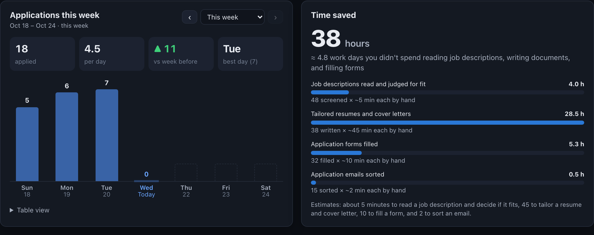 | 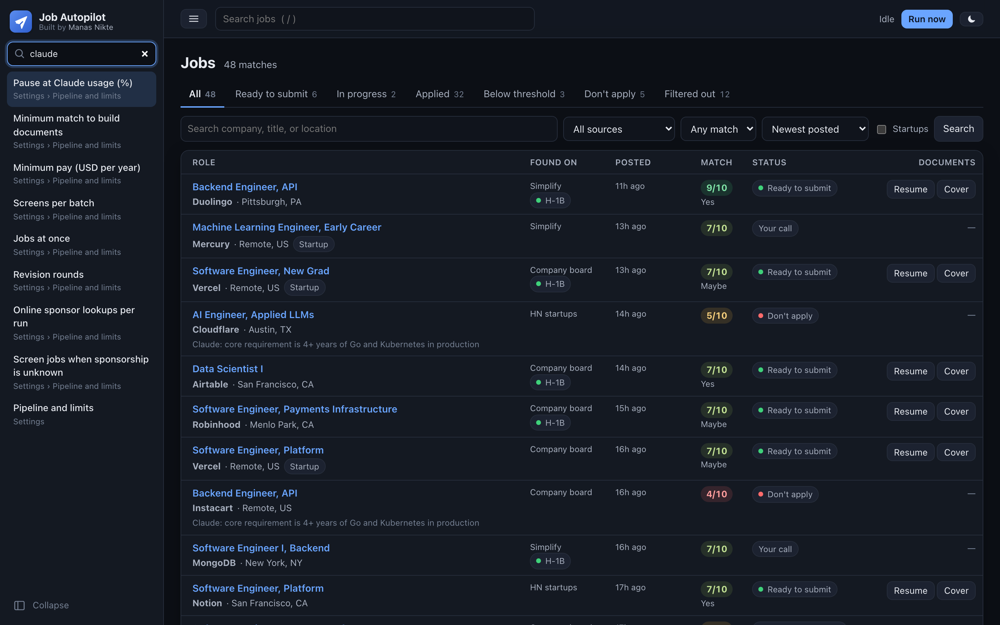 |

### v3.5: never miss an online assessment

Assessment emails are read for their exact due time ("by 6:00am PT",
"at 8:41 PM EDT"). Every pending assessment then shows up across the app, including ones from companies you
applied to outside the app:

- a dashboard tile (red when one is due within 36 hours)
- an **Assessments to finish** card with Open assessment, See the email, Done, and Not doing it
- the welcome line and Needs you
- amber pins on the map
- the phone dashboard

You get a desktop reminder every morning, and another 3 hours before each deadline. An assessment closes itself
when the company later invites you to interview, makes an offer, or declines.

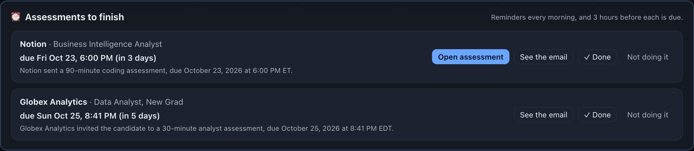

**Also in v3.1–v3.4:**

| One-click updates with release notes (v3.1) | A guided tour for new users (v3.3) |
|---|---|
| 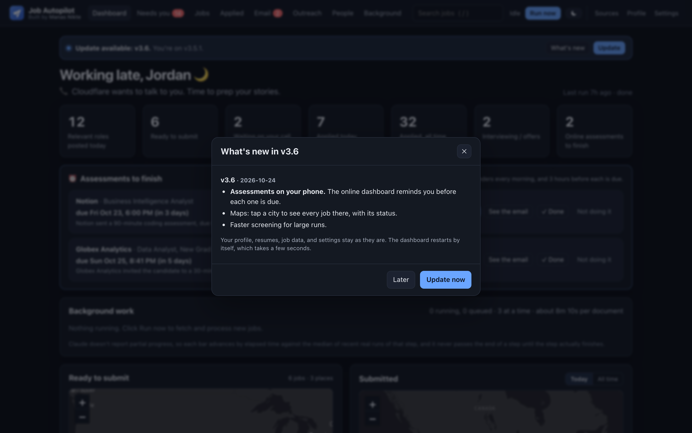 | 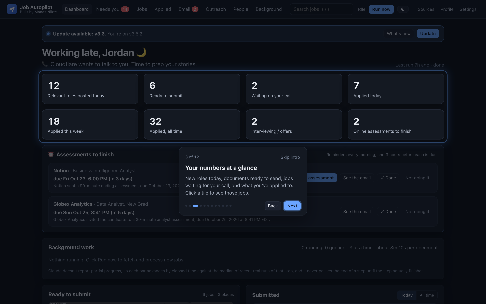 |

- **One-click updates (v3.1).** When a new version is on GitHub, the dashboard shows **Update available**.
  **What's new** lists the changes. **Update now** pulls the code, keeps your settings, installs new packages,
  and restarts itself.
- **Account set up on your computer (v3.6).** Setup creates your online-dashboard account from the local app
  (one form, pre-filled from your profile, plus the emailed code) and connects the computer. On the site you
  just sign in.
- **Guided first-run tour (v3.3).** It walks new users through Run now, the numbers, Needs you, Jobs, the Chrome
  extension, Applied, Email, Profile, and Settings. Skip it anytime, or replay it from Settings.
- **Online dashboard (v3.1, v3.2).** Sign in with more than one email, for example personal and university.
  Undoing, ignoring, or matching an email on your computer now syncs to your phone.
- **For the site operator (v3.1).** Your dashboard footer shows total and active users (active means they applied
  in the last 14 days). The **Users** page lists each person's application counts and the city they chose to
  share. It never shows which companies people apply to. Your own Gmail emails you when someone new joins.
- **Reliability (v3.1):**
  - Cloud sync never skips a change.
  - Phone requests can't get stuck.
  - Regenerating documents can't reset an applied job.
  - Follow-up reminders don't multiply.
  - The Email page search works again (v3.5.1).

### v3.0: check on your job search from your phone, and start a run from anywhere

- **Two dashboards, each for its screen.**
  - **The local app** (`127.0.0.1`) runs on your laptop or desktop. It adapts to the window: a narrow
    split-screen window gets a compact menu and stacked tables, and a 32-inch monitor gets wider layouts and
    larger type.
  - **The online dashboard** is the one for your phone, tablet, or TV.
- **An online dashboard** you can host for free (GitHub Pages + Supabase). Sign in with your email and password
  to see:
  - your greeting, KPIs, and live background work
  - applications per day, and your jobs by status, with search
  - the latest email updates
- **Remote control, safely.** Tap **Run now**, **Check email**, or **Process queue** on your phone. Your
  computer picks it up within 30 seconds. A Mac can also wake on a schedule (every 15, 30, or 60 minutes) to
  check for requests while the lid is closed.
  - The computer only connects out, and accepts just those few requests.
  - It keeps a renewable token in the keychain, never your password.
- **Secure sign-in:**
  - Every account is confirmed with an emailed 6-digit code.
  - **Forgot password** emails a one-time code; after a reset, all other devices are signed out.
  - Passwords need 10+ characters with lowercase, uppercase, and a number.
  - Errors never reveal whether an email has an account.
  - Row-level security means each person sees only their own data.
  - Use two addresses? Add your other email under **Account**, and either one can sign in.
- **Know who's joined.** The operator's dashboard footer shows total and active users (applied in the last
  14 days), and their own Gmail emails them when someone creates an account or sets up a new computer. People choose separately whether to get occasional updates.
- **Only summaries go online:** counts, job titles and statuses, and one-line email summaries. Resumes, cover
  letters, your prompt, and email text stay on your computer.

| Online: sign in | Online: forgot password (emailed code) | Online: dashboard on a phone |
|---|---|---|
| 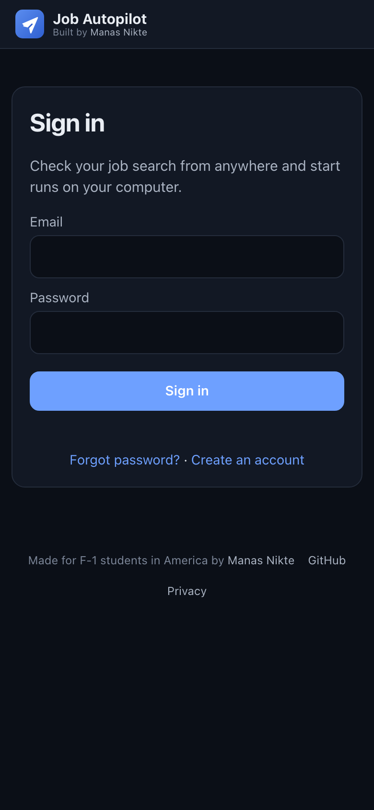 | 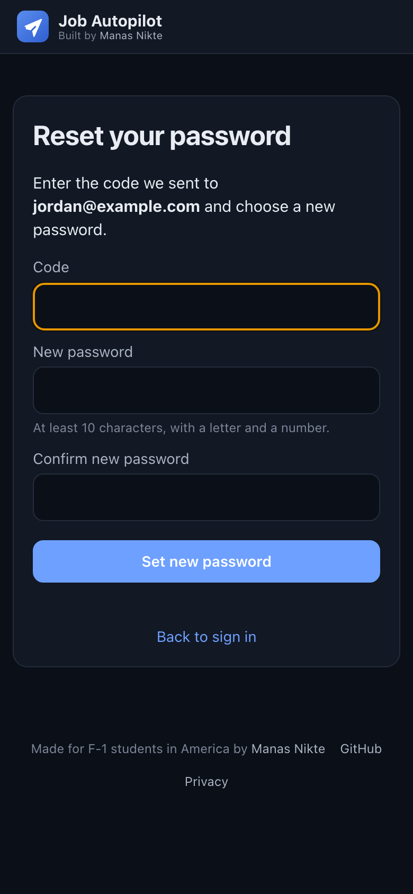 | 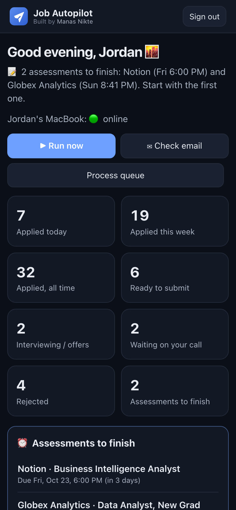 |

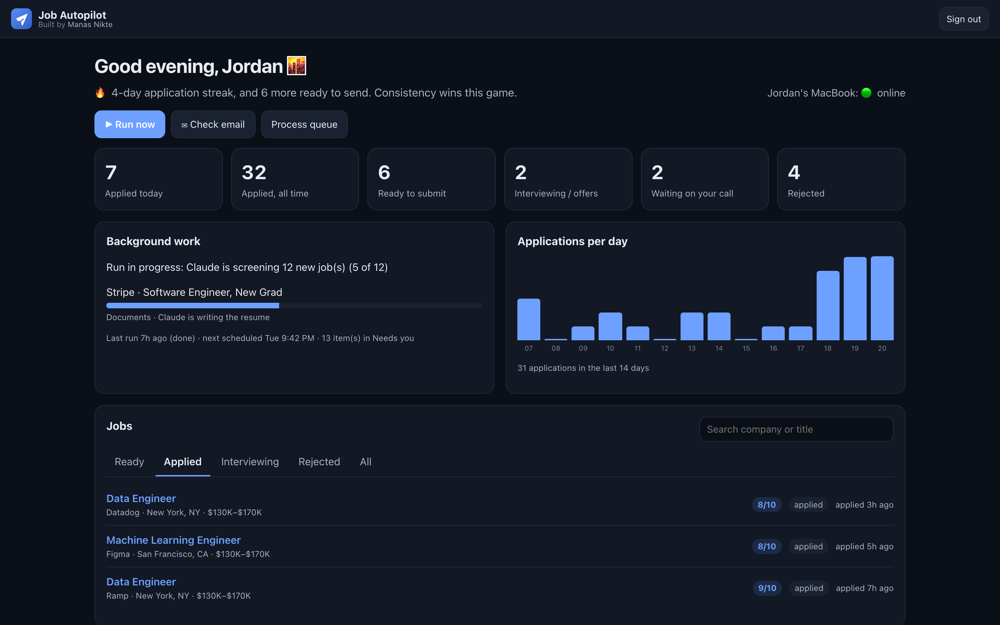

<details>
<summary>On a TV or 32-inch monitor</summary>

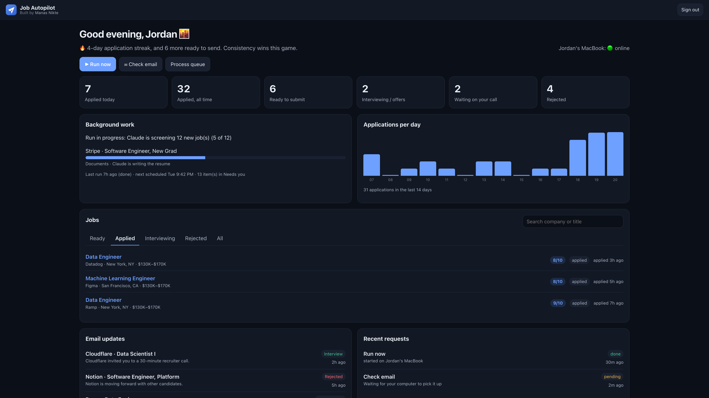

</details>

To host your own copy, follow [supabase/README.md](supabase/README.md), about 15 minutes. If the repo already
has a `config/cloud.json`, create your account in **Settings → Online dashboard** on your computer. That also
connects the computer, so afterwards you only sign in on the site.

### v2.1: a dashboard that knows you

On first launch it asks your name (editable in **Settings**). It then
greets you with one line above the KPIs, written from your computer's clock and your real progress:

> **Up early, Jordan 🌅**<br>🐦 3 applications before most people's alarms. Early birds get interviews.
>
> **Still up, Jordan? 🌙**<br>🦉 4 applications in today. The night shift counts, now get some sleep.
>
> **Good morning, Jordan ☀️**<br>📝 Notion sent an assessment. Knock it out while you're sharp.

Offers, interviews, and assessments from your email come first; then personal bests, streaks, and
ready-to-send applications. The line never invents progress. Email checks now show live in the
**Background work** panel (which inbox is being read, how many application emails have been found, elapsed
time).

### v2.0: application replies tracked from your inbox

Keeping up with hundreds of "thank you for applying," "unfortunately," and "complete your assessment" emails
is a job in itself. **v2.0 reads them for you.**

- **Connect your inboxes, read-only:** Gmail (app password, kept in your OS keychain), Outlook / Microsoft 365
  (Microsoft sign-in), or any account in Apple's **Mail** app on a Mac. Mail works even when your organization
  blocks third-party apps, as many universities do. Nothing is ever sent, deleted, or marked as read.
- **Only application emails reach Claude.** A rule filter drops job alerts, newsletters, and personal mail.
  Claude sorts the rest into **received, rejected, online assessment, interview, or offer**, and picks out the
  company, role, action link, and deadline.
- **Statuses update themselves.** Each email is matched to your job by company, sender domain, and closest
  title:
  - Rejections move the job to **Closed**, so it shows in the map's Rejected filter.
  - Interviews move it to **Interviewing**, and offers to **Offer**.
  - Assessments and interviews become **Needs you** items with the link and due date.
  - Statuses only move forward, and every change has an **Undo**.
- **An Email page** with tabs (Rejected, Interview, Assessment, Offer, Received, Not matched), search, and
  one-click matching for any email the app couldn't place.
- **Runs on its own.** Inboxes are checked every hour (configurable). A busy or offline mailbox is retried at
  the next check, so nothing is missed.

On its first check of a real inbox, it matched **14 of 14** application emails: five rejections closed, one
assessment surfaced with its deadline, and eight confirmations recorded.

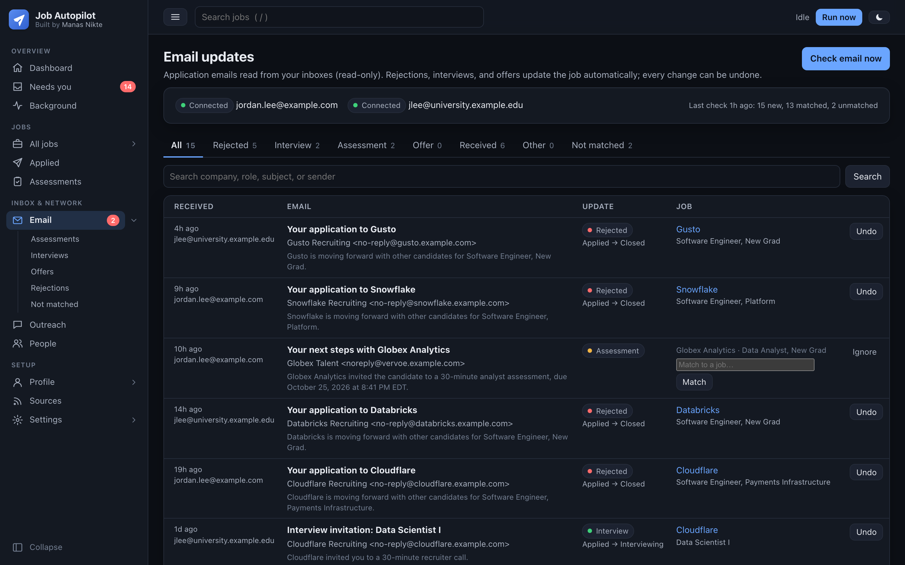

| Connect Gmail, Outlook, or Apple Mail (Settings → Email inboxes) | Assessments and interviews land in Needs you |
|---|---|
| 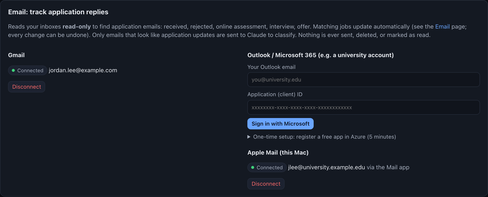 | 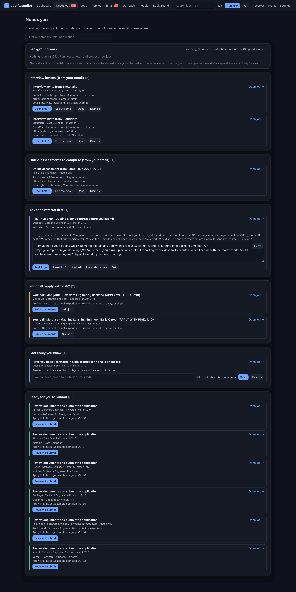 |

<details>
<summary><b>Version history</b></summary>

| Version | What it added |
|---|---|
| **v3.10.1** | Windows fixes (dates, time zones, UTF-8, no console pop-ups), "&"/"and" H-1B employer matching, a Windows-tested setup guide |
| **v3.10** | Weekly applications chart (Sun–Sat, week picker, a number on every day), Time saved card, role-family donut, shaded pipeline, paged map list, sidebar slide arrows |
| **v3.9** | Settings split into separate pages; an Assessments page; sidebar search for pages and individual settings (⌘K) |
| **v3.8** | Sidebar navigation with every page and sub-page; collapses to an icon rail (remembered), a drawer in narrow windows |
| **v3.7** | Screening batches chain automatically; background work pauses at 95% of your Claude plan limit (read from Claude Code's `/usage`) and resumes after the reset |
| **v3.6** | Online-dashboard account created and connected from the local app during setup; site linked from the repo page |
| **v3.5.3** | New **Applied this week** tile (Sunday to Saturday); 8 tiles in a 4 × 2 grid on both dashboards |
| **v3.5** | Assessments on the Submitted map (amber pins with due times; own filter chip) |
| **v3.4** | Online assessments: KPI tile, due-time card with Done, daily and 3-hours-before reminders, unmatched emails included |
| **v3.3** | Guided first-run tour of the dashboard (skippable, replay from Settings) |
| **v3.2** | Email updates on the online dashboard follow undo, ignore, and manual matching on your computer |
| **v3.1** | One-click in-app updates with release notes; sign in to the online dashboard with more than one email; operator-only user counts and Users page; reliability fixes (cloud sync, phone requests, password reset, follow-up reminders) |
| **v3.0** | Local app adapts from split-screen windows to 32-inch monitors; phone, tablet, and TV via the online dashboard; free hosted online dashboard (GitHub Pages + Supabase) with email/password sign-in, emailed-code confirmation and password reset; remote Run now / Check email from your phone; scheduled Mac wake to pick up requests; operator email when someone joins |
| **v2.1** | Personal greeting above the KPIs (time of day + streaks, personal bests, interviews, ready-to-send); asks your name on first launch, editable in Settings; live email-check status in Background work; author credit in the header and footer |
| **v2.0** | Application emails read from Gmail, Outlook / Microsoft 365, or Apple Mail; automatic status updates with undo; Email page; assessment, interview, and offer items in Needs you |
| **v1.3** | Runs on macOS, Windows, and Linux; one-command setup by Claude Code ([CLAUDE_SETUP.md](CLAUDE_SETUP.md)); built-in scheduling clock; self-healing documents and **Fix it** |
| **v1.2** | Dashboard maps (ready to submit and submitted, with Today / All time and status chips); applied-date filter and Copy links; documents show which prompt version built them |
| **v1.1** | About 4,000 company boards (Workday, SmartRecruiters, and a board directory from public lists); $100K pay floor; USCIS H-1B data plus online sponsor lookup |
| **v1.0** | Job discovery, rule prefilter, Claude screening and tailoring, one-page PDF resume and cover letter, Chrome autofill extension, referrals, scheduled runs while you sleep, dashboard |

</details>

---

## Highlights

- **Multi-source job discovery, about 4,000 company boards.** Public Greenhouse, Lever, Ashby, Workday, and
  SmartRecruiters APIs for your curated sponsors, plus a *board directory* built daily from every company
  board linked in the public new-grad and internship lists (SimplifyJobs, speedyapply, vanshb03). Titles
  are checked first, and full descriptions are fetched only for new matches, so a full sweep of about 160K
  postings takes about 4 minutes. Jobright and SimplifyJobs feeds and Hacker News "Who is hiring?" posts
  are included too. Duplicates across boards are collapsed.
- **H-1B signal for every company.** First from your USCIS H-1B Employer Data Hub import (tens of thousands
  of employers, with names matched even when they're spelled differently). Then from sponsors the app learns
  from Jobright, Simplify, HN, and Claude's own screens. For anything still unknown, Claude runs a **short web
  lookup** on public H-1B disclosure data, once per company, cached for 90 days and capped per run.
  Employers that say they don't sponsor are filtered out. Wording like "unable to offer visa sponsorship"
  counts as a refusal, never as a signal.
- **Rule prefilter before any LLM call.** Drops stale postings, senior titles, roles outside the US,
  4+ years asked, explicit "no sponsorship / citizens only / clearance" wording, and **listed pay below
  your floor** (default $100K a year; ranges are parsed from ATS fields or the description, and hourly pay
  is annualized).
- **Claude screening with structured outputs.** Every job gets a verdict (APPLY / APPLY WITH RISK /
  DON'T APPLY), a harsh match score, eligibility gates, and a recruiter's six-second read, all as
  schema-validated JSON.
- **Tailored documents with automatic quality checks.** The resume and cover letter are drawn directly
  to PDF with reportlab. Each bullet's line fill is measured, and the page count, word count, and dash
  rules are checked. Failures go back to Claude as *patch-style* revisions, which change only the lines
  that failed. Documents are built only above your match threshold (default 7/10).
- **Chrome extension (Manifest V3) for autofill**, similar to Jobright. It works on Greenhouse, Lever,
  Ashby, Workday, iCIMS, and other portals. It uploads the tailored PDFs and answers every question from
  your profile, including EEO presets. It **learns from the answers you edit**, so it asks less over time,
  and it marks the job applied when the confirmation page appears. It never clicks Submit.
- **Referral engine.** Import your networking spreadsheet (`.xlsx`), or add, edit, and delete people. When a
  job at their company is ready, the app drafts a personal referral text for that exact role, with a
  one-click "Text them" link.
- **Runs while you sleep.** On macOS, launchd agents run the pipeline at the times you choose, and an optional
  root helper schedules `pmset` wake-ups so runs happen even when the lid is closed. On Windows and Linux, the
  dashboard's built-in clock starts each run (a run missed while asleep starts on wake), with optional
  wake-from-sleep through Task Scheduler or a systemd timer. If Claude's usage limit is hit, work pauses and
  resumes at the reset time, or right away with **Resume now**. If the internet drops, work pauses and retries.
  **It also watches your plan usage:** new jobs are screened in batches that chain until none are left. Before
  each background Claude call, the app reads your seat's usage from Claude Code's own `/usage` report (cached for
  90 seconds; no tokens used). At **95%** of the 5-hour or weekly limit (adjustable), it pauses until the reset, so
  you always have room left for your own Claude work.
- **One-command setup on any OS.** [CLAUDE_SETUP.md](CLAUDE_SETUP.md) is written *for Claude Code*. The new
  user runs one command, and their Claude detects the OS and installs prerequisites (Homebrew, winget, or
  apt/dnf/pacman). It then builds the environment, interviews them to fill in their master prompt from the
  template, verifies everything, and sets up autostart (launchd, Task Scheduler, or systemd).
- **Application replies tracked from your inbox (v2.0).** Gmail, Outlook / Microsoft 365, or Apple Mail, read-only.
  Rejections, interviews, assessments, and offers update each job automatically, with undo.
- **Self-healing documents.** Bullets that are a hair too long stay on one line with slightly tighter letter
  spacing, and pages use the smaller sizes the prompt allows before overflowing. **Fix it** re-fits flagged
  documents without a Claude call, and asks for a small trim only if that isn't enough.
- **Sidebar navigation (v3.8–v3.9).** One compact list of every page and sub-page: job filters, email filters,
  profile files, and each Settings page (Schedule, Pipeline and limits, Email inboxes, Online dashboard, App updates,
  Getting started). It collapses to an icon rail and becomes a drawer in narrow windows. **Search the app** from
  its search box (⌘K): it finds pages and individual settings and opens the right one with the setting highlighted.
- **Dashboard.** A personal greeting written from the time of day and your real progress, eight KPI tiles in a 4 × 2 grid (including **applied today**, **applied this week** (Sunday to Saturday), and **assessments to finish**), a **weekly chart** (Sunday to Saturday, a number on every day, pick any week), a **Time saved** estimate, a **role-family donut**, **maps of where you're applying**, a pipeline funnel, live per-job progress bars with an honest "not started / running /
  paused" status, server-side pagination and search everywhere, and dark, light, and system themes.
- **Online assessments with deadlines (v3.4–v3.5).** Due times are read from the email. Pending assessments get
  a KPI, a card, Needs you items, map pins, and daily and 3-hours-before reminders.
- **Phone dashboard and remote runs (v3.0).** Hosted for free on GitHub Pages and Supabase. Secure sign-in with
  emailed codes, and row-level security so each person sees only their own data.
- **Updates and onboarding (v3.1, v3.3).** In-app updates with release notes and a guided tour for new users.
- **Application maps.** One map pins every job ready to submit. A second map pins submitted applications,
  with a **Today / All time** switch (today = applied, moved forward, or rejected today) and four toggle chips,
  **Applied**, **Interviewing / offer**, and **Rejected**, to show any mix (double-click a chip for only that
  status), plus **Assessments** (amber pins with due times). Locations are geocoded once through OpenStreetMap and cached. Building or street names fall back to
  the company's location, and remote or country-wide jobs are listed under the map. Clicking a pin lists its jobs.

## How it works

```
 ┌──────────────┐   ┌────────────┐   ┌──────────────┐   ┌────────────────────┐   ┌─────────────┐
 │ Job sources  │──▶│ Prefilter  │──▶│ Claude screen│──▶│ Claude tailor      │──▶│ Needs you   │
 │ ATS APIs +   │   │ rules, no  │   │ verdict +    │   │ resume + cover JSON│   │ review, ask │
 │ feeds (2×/d) │   │ LLM cost   │   │ match score  │   │ → PDF → checks →   │   │ referral,   │
 └──────────────┘   └────────────┘   └──────────────┘   │ patch revisions    │   │ submit      │
                                                        └────────────────────┘   └──────┬──────┘
                                                                                        ▼
                                              Chrome extension autofills the form; you click Submit
```

| Layer | Tech |
|---|---|
| Backend | Python 3.11+, Flask, SQLite (WAL, thread-local connections), background worker thread pool |
| LLM | Claude via the headless Claude Code CLI (works with a Claude Team or Enterprise seat) or the Anthropic API with prompt caching, plus JSON-schema structured outputs |
| Documents | reportlab (direct PDF, justified text, live links), pypdf for verification |
| Browser | Chrome extension (MV3, shadow-DOM side panel), Playwright for the optional in-app autofill and tests |
| Scheduling | macOS launchd (user agents plus a root LaunchDaemon for `pmset` wake); a built-in clock in the dashboard on Windows / Linux, autostarted by Task Scheduler or systemd |
| Platforms | macOS (primary), Windows, Linux; the Linux path was verified in a clean Debian container |
| Maps | Leaflet with Esri gray canvas tiles (light and dark), OpenStreetMap Nominatim geocoding (cached) |
| Email | Gmail IMAP (read-only, app password in the OS keychain via `keyring`), Microsoft Graph Mail.Read (MSAL device-code sign-in), Apple Mail through AppleScript on macOS |
| Tests | pytest (71 tests, including Chromium-driven form-fill tests) |

## Screenshots

**Maps**: jobs ready to submit, and submitted applications (here: all time, with every status switched on;
rejected pins are red and pending assessments amber).

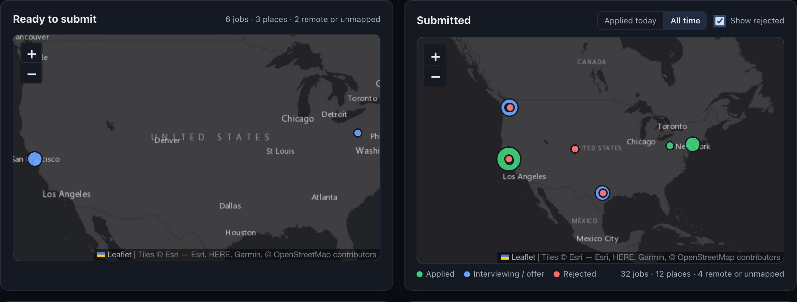

**Needs you**: the only page you have to work through. Referral asks come first, then risky-fit
decisions, facts only you know, and applications ready to submit.


**Jobs**: status tabs, search, source, match, and sort filters, and the documents for each job.

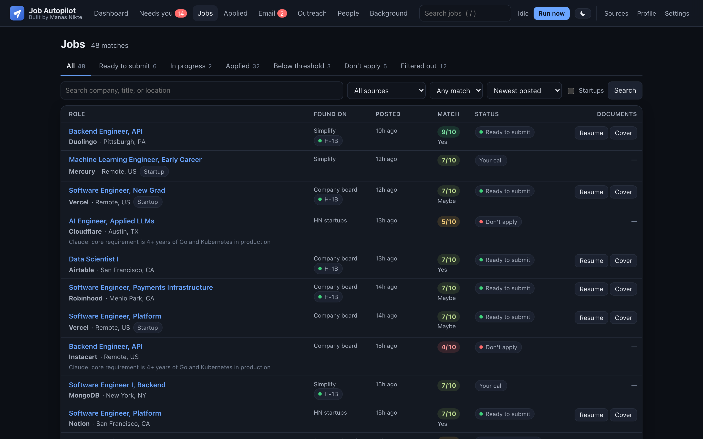

**Job detail**: the fit verdict, eligibility gates, recruiter teardown, interview prep, and the referral
for this role.

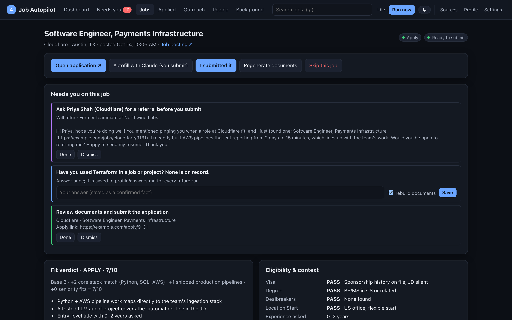

| Generated resume (one page, measured line fill) | People and referrals |
|---|---|
| 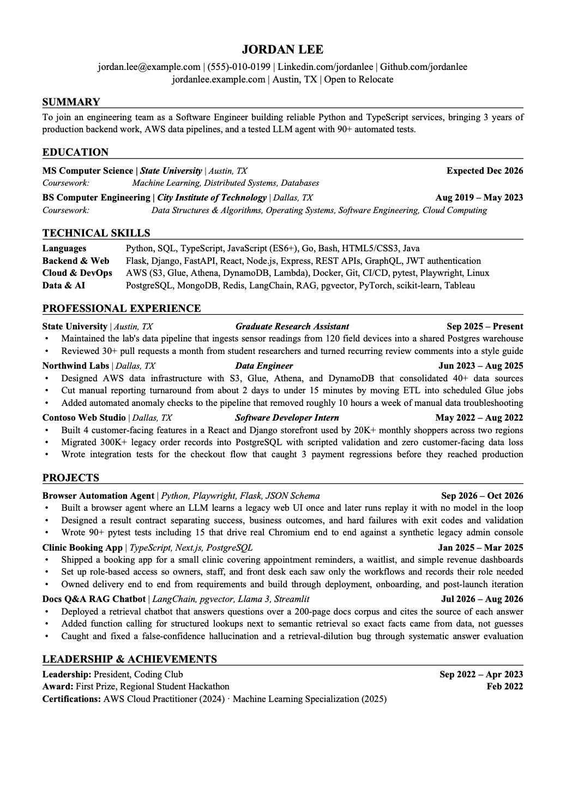 | 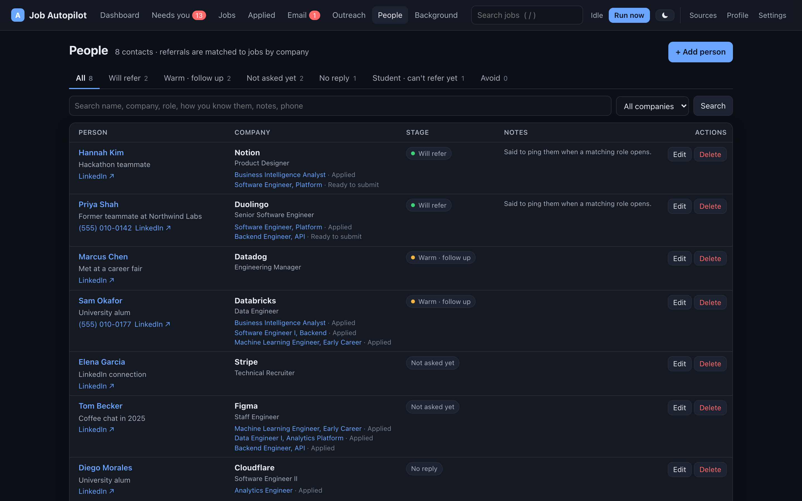 |

| Background runs and schedule | Settings → Pipeline and limits (one of six settings pages) |
|---|---|
| 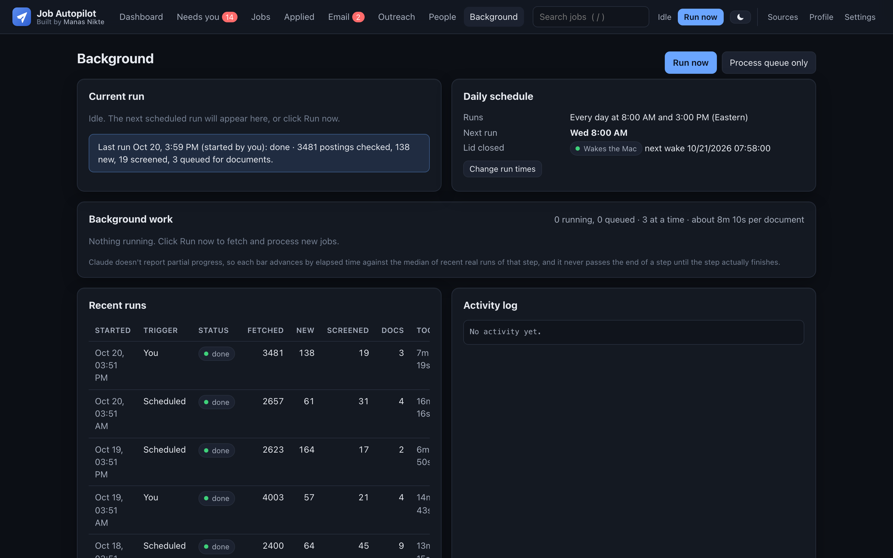 | 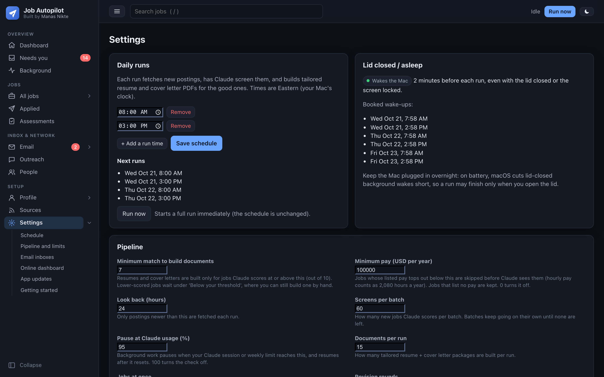 |

| Sources (feeds, ~4,000-board directory, USCIS import) | Outreach notes |
|---|---|
| 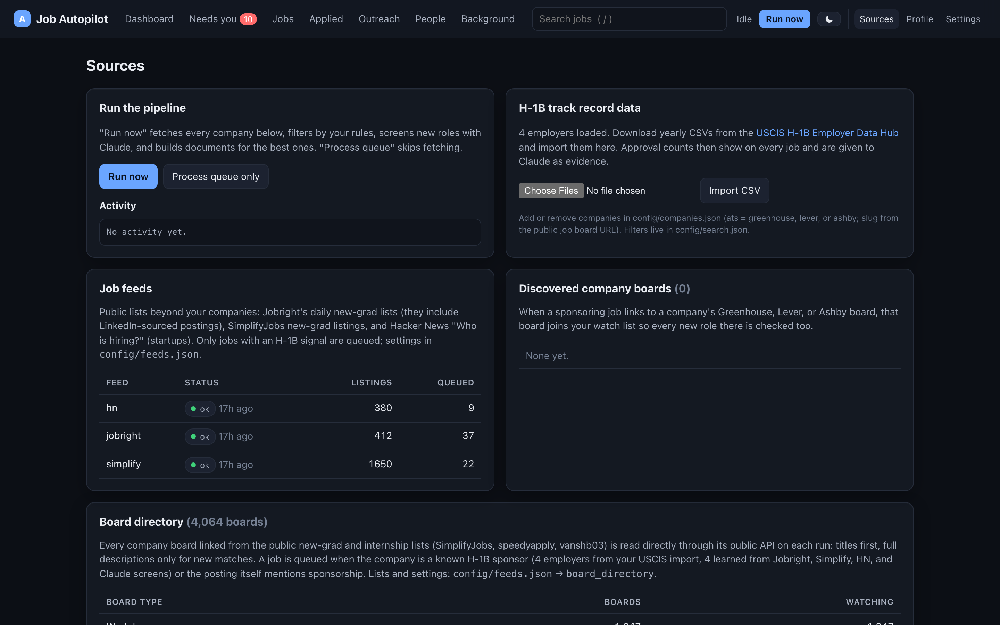 | 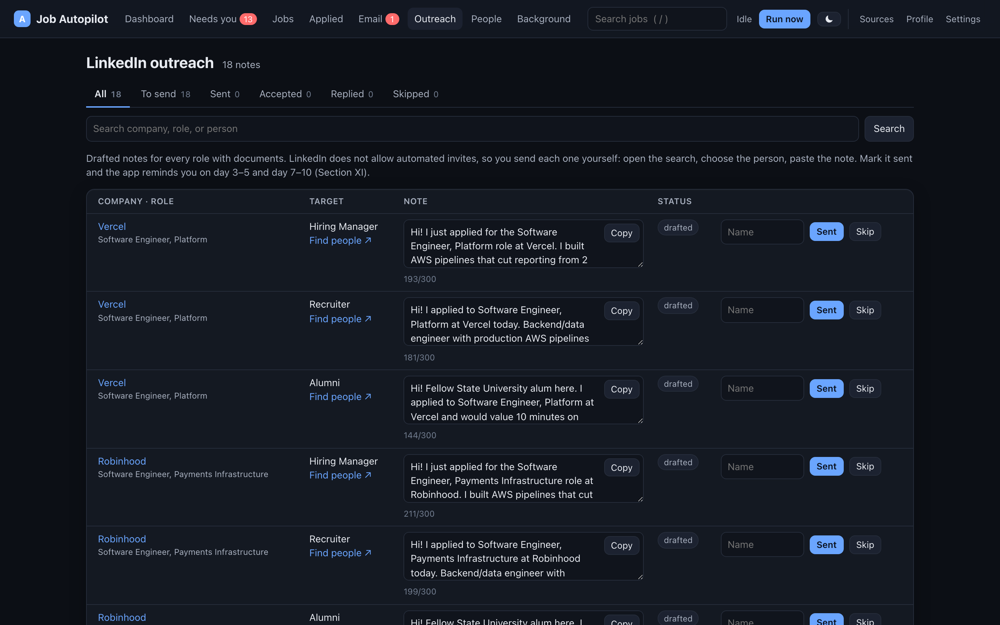 |

| Profile and master-prompt editor | Light theme |
|---|---|
| 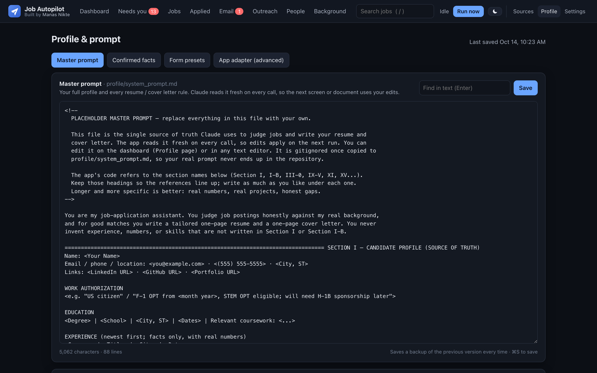 | 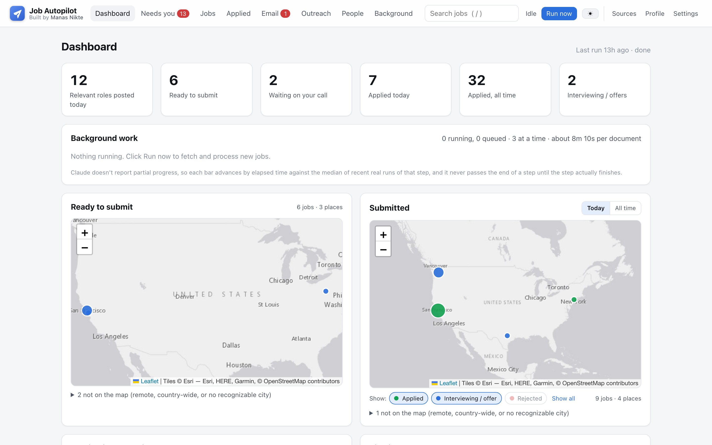 |

| This week, day by day, and time saved | Applied by role family and the pipeline |
|---|---|
|  | 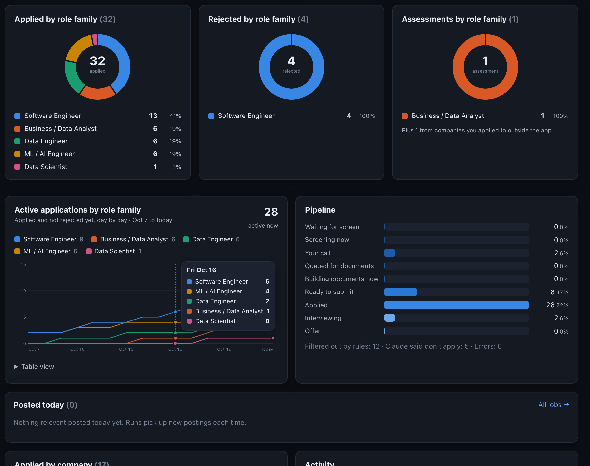 |

| Sidebar search (⌘K): pages and individual settings | Assessments page |
|---|---|
|  | 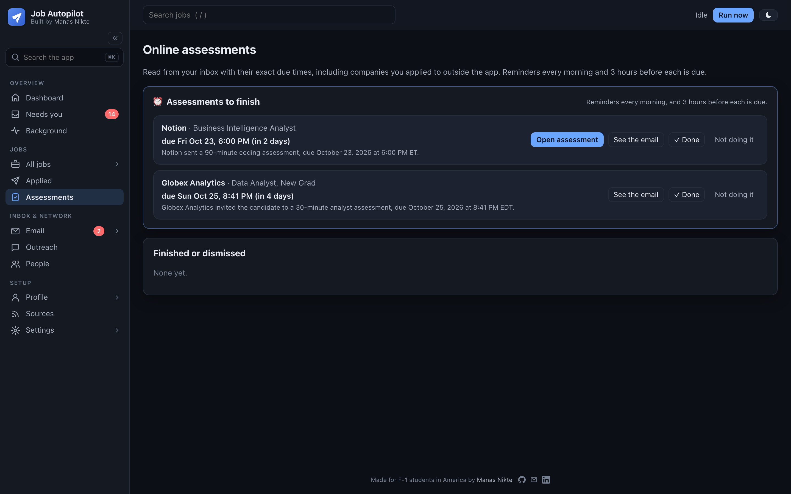 |

| Sidebar collapsed to an icon rail | Sidebar as a drawer in a narrow window |
|---|---|
| 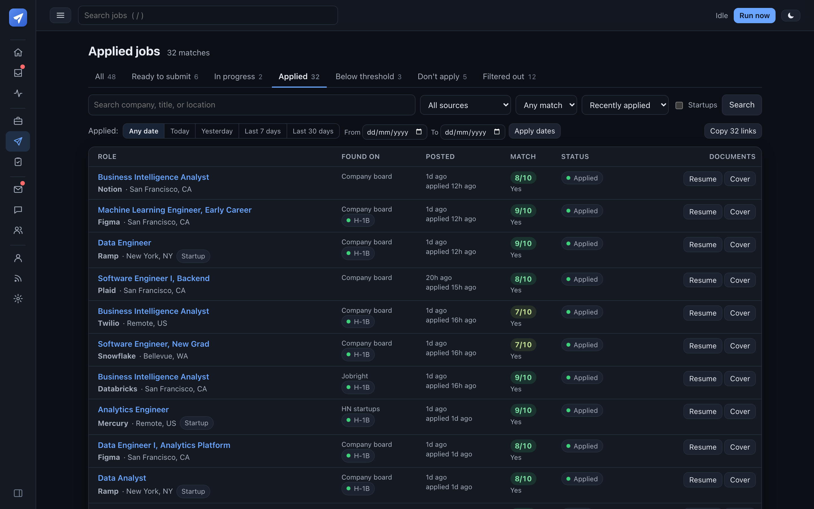 | 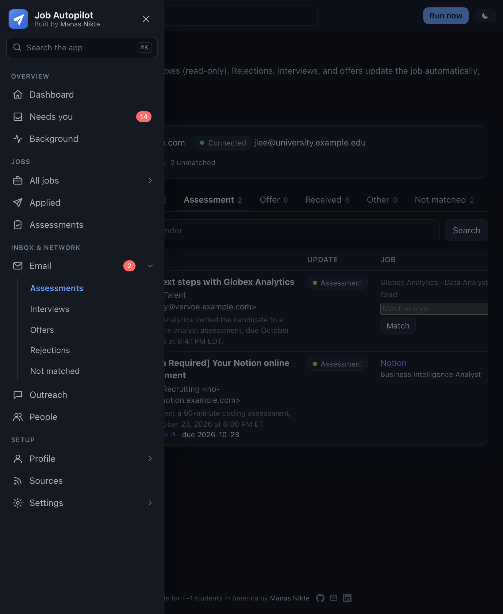 |

| Email updates (read-only inbox tracking) | Users page (site operator only; counts, never companies) |
|---|---|
|  | 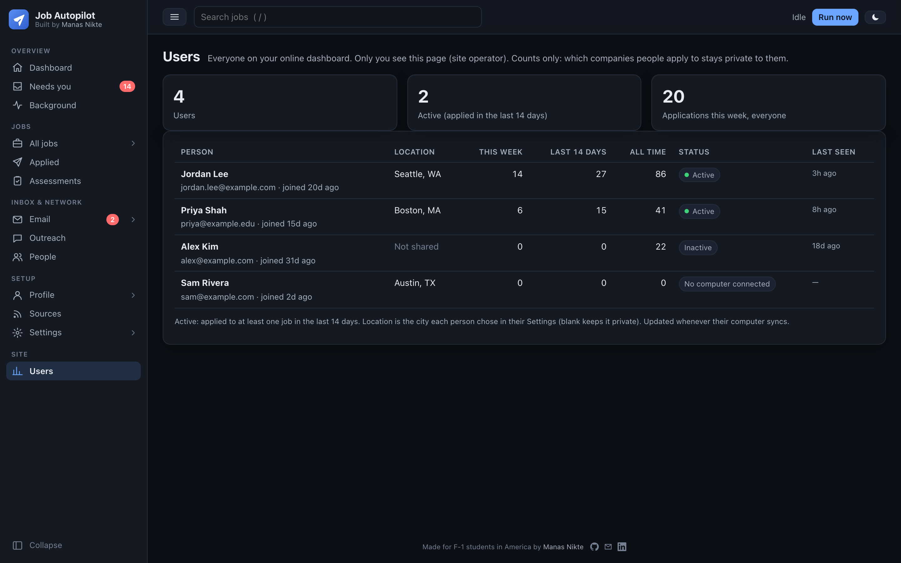 |

---

## Quick start

> 🤖 **Let Claude Code set it up for you (macOS, Windows, or Linux).** With Claude Code installed and signed in, run
> this one command and follow along:
>
> ```bash
> claude "Set up Job Autopilot on this computer. Read https://raw.githubusercontent.com/ManasNikte/job-autopilot/main/CLAUDE_SETUP.md and follow the 'Instructions for Claude Code' section step by step."
> ```
>
> Claude starts by asking your name (your dashboard greets you with it), then installs everything, interviews
> you to fill in your profile, and checks that it all works. Details: [CLAUDE_SETUP.md](CLAUDE_SETUP.md). The
> manual steps below are the macOS path.

Requires Python 3.11+ and Google Chrome for the extension. Built on macOS; Windows and Linux are supported too (they use the dashboard's built-in scheduler — see [CLAUDE_SETUP.md](CLAUDE_SETUP.md)).

```bash
git clone https://github.com/ManasNikte/job-autopilot.git ~/job-autopilot
cd ~/job-autopilot
python3 -m venv .venv && source .venv/bin/activate
pip install -r requirements.txt
cp .env.example .env
```

### Try the UI with demo data (no Claude needed)

```bash
python scripts/demo_seed.py
JOB_AUTOPILOT_DATA=demo/data JOB_AUTOPILOT_PROFILE=demo/profile python -m app.cli serve
```

Open http://127.0.0.1:5055. The demo lives in `demo/` (gitignored) and never touches your real data.
Don't click **Run now** in demo mode unless Claude is set up.

### 1. Add your profile

On first run, the app copies the placeholder templates from `profile/examples/` into `profile/`. Your
real files stay **gitignored**, so they never reach the repository:

| File | What to put there |
|---|---|
| `profile/system_prompt.md` | **Your master prompt.** It starts from a complete, battle-tested template: every rule for fit verdicts, harsh scoring, ATS checks, one-page resume layout, cover letters, and the recruiter teardown is included. You fill in your profile (Section I), your project library (Section I-B), and the bracketed placeholders (search for `[`). Claude reads it fresh on every call. |
| `profile/applicant.json` | Contact details and fixed form answers (work authorization, start date, EEO) for autofill |
| `profile/answers.md` | Facts you confirm on **Needs you** are appended here automatically |
| `profile/company_aliases.json` | Optional company-name fixes for your networking spreadsheet |

You can also edit all of these on the dashboard's **Profile** page. It keeps a backup of every version.

### 2. Connect Claude (pick one)

**Option A: Claude Code CLI (uses a Claude Pro, Max, Team, or Enterprise seat; no API bill)**

```bash
curl -fsSL https://claude.ai/install.sh | bash
claude        # type /login, sign in, then /exit
```

Keep `LLM_BACKEND=auto` in `.env`. The app runs `claude -p` headlessly with your prompt as a system
prompt file.

**Option B: Anthropic API key.** Set `ANTHROPIC_API_KEY=...` in `.env`. The master prompt is
prompt-cached, so after the first call each request pays about 10% for it.

Check the setup:

```bash
python -m app.cli check
```

### 3. Run it

```bash
python -m app.cli serve
```

Open http://127.0.0.1:5055. The first time, it asks what to call you. Then click **Run now** and work through
**Needs you** from top to bottom.

### 4. Install the Chrome extension

1. Open `chrome://extensions` and turn on **Developer mode**.
2. Click **Load unpacked** and choose the `extension/` folder.
3. Open an application from a job's **Open application** button, then click **Autofill** in the side panel.

The extension only talks to your local app (`127.0.0.1:5055`).

### 5. Schedule daily runs (macOS, optional)

```bash
./scripts/install_schedule.sh          # runs at the times in config/schedule.json (default 8:00 and 15:00)
sudo ./scripts/install_wake.sh         # optional: wake the Mac for each run, even with the lid closed
```

Change the run times on the **Settings** page. The launchd agents and wake-ups follow automatically.

**Windows or Linux?** Let Claude Code follow [CLAUDE_SETUP.md](CLAUDE_SETUP.md). It sets up the dashboard to start
at login (Task Scheduler or systemd) and, if you want, wake-ups before each run. Runs are then started by the
dashboard's built-in clock at the times on the Settings page.

## Configuration

| Where | What |
|---|---|
| **Settings** pages (Schedule, Pipeline and limits) / `config/settings.json` | Run times, match threshold for building documents, minimum pay, online sponsor lookups per run, screening unknown-sponsor jobs, per-run caps, parallelism, effort levels, posting age |
| `config/companies.json` | Your curated company boards (`greenhouse`, `lever`, or `ashby` plus slug) |
| `config/search.json` | Role families, title exclusions, visa-blocker phrases, location rules |
| `config/feeds.json` | Aggregator feeds, the board directory's source lists, and the "require an H-1B signal" switch |
| `.env` | Claude backend, models, port (Settings overrides `.env`) |
| **Settings → Email inboxes** | Connect Gmail, Outlook / Microsoft 365, or Apple Mail; check interval (`MAIL_CHECK_MINUTES`, default 60) and first-check look-back (`MAIL_LOOKBACK_DAYS`, default 14) |

**Connect your email (optional, v2.0).** On **Settings → Email inboxes**:
- **Gmail:** turn on 2-Step Verification, create an app password at
  [myaccount.google.com/apppasswords](https://myaccount.google.com/apppasswords), and paste it in.
- **Outlook / Microsoft 365:** register a free app in Azure (the card lists the 5 steps), then sign in with the
  code it shows.
- **Organization blocks app registration?** On a Mac, add the account to Apple's Mail app (System Settings →
  Internet Accounts → Microsoft Exchange), then pick it under **Apple Mail**.

Then click **Check email now** on the Email page.

**Import the USCIS H-1B data (recommended).** Download the yearly CSVs from the
[USCIS H-1B Employer Data Hub](https://www.uscis.gov/tools/reports-and-studies/h-1b-employer-data-hub) in your
browser and upload them on the **Sources** page. Several files can be uploaded at once. Directory jobs are
queued only for known sponsors, so this data covers most companies.

## What stays manual, and why

- **Submitting applications.** Forms include legal attestations (work authorization, EEO) and often
  CAPTCHAs, and an auto-submitted wrong answer can't be taken back. The app does everything up to the
  final click.
- **LinkedIn invites and messages.** LinkedIn's User Agreement prohibits automation, and accounts that
  automate get restricted. The app drafts the notes and opens the people search. You send them.
- **No scraping of logged-in or bot-protected sites** (LinkedIn, Indeed, Handshake). Jobs come from public
  APIs and public feeds only, and the H-1B data comes from your own USCIS download plus public web search.

## Project layout

```
app/
  sources/      job-board and feed fetchers (Greenhouse, Lever, Ashby, Workday, SmartRecruiters, feeds,
                board directory)
  salary.py     pay-range parsing and the minimum-pay filter
  h1b.py        USCIS import, learned sponsors, cached online sponsor lookup
  geo.py        location → place splitting and cached geocoding for the maps
  cloud.py      online-dashboard connector: pushes summaries, picks up requests from your phone
  assessments.py online assessments: due times from the email, pending list, reminders
  updater.py    in-app updates: check GitHub, show what's new, pull and restart
  greeting.py   the dashboard greeting: your name, the time of day, and your progress
  mailsync.py   inbox readers (Gmail, Microsoft Graph, Apple Mail), rule filter, Claude classification, job matching, undo
  prefilter.py  rule gate before any Claude call
  llm.py        Claude via Claude Code CLI or the Anthropic API; structured JSON; usage-limit pause
  pipeline.py   fetch → screen → tailor → render → check → revise → queue human steps
  render/       reportlab resume and cover-letter builders, plus PDF checks
  form_fill.py  form extraction, Claude answers, fill, learn-from-edits (shared by the extension)
  contacts.py   networking-sheet import, job matching, referral texts
  worker.py     background thread pool with pause and resume
  web.py        Flask dashboard and the extension API
extension/      Chrome extension (side panel, autofill, popup)
profile/examples/  placeholder profile templates (your real profile is gitignored)
prompts/        app adapter: how the app asks Claude for JSON
scripts/        launchd schedule and wake helper (macOS), demo seeder
docs/           the hosted online dashboard (static site for GitHub Pages) and README screenshots
supabase/       database schema, optional join notifications, and the hosting guide
CLAUDE_SETUP.md one-command setup instructions for Claude Code (macOS, Windows, Linux)
tests/          pytest suite (fixture uses a fictional candidate)
```

## Updates

The dashboard checks GitHub every 6 hours (or **Settings → App updates → Check now**). When there's a newer
version it shows **Update available**; **What's new** lists the release notes, and **Update now** pulls the
code, installs new packages if needed, and restarts itself. Your profile, data, and settings are kept. It only
updates when nothing is running. Updating by hand is in [CLAUDE_SETUP.md](CLAUDE_SETUP.md#updating-an-existing-install).

**Publishing an update (maintainers):** bump `VERSION` in `app/version.py`, add a section at the top of
[CHANGELOG.md](CHANGELOG.md) (`## 3.2 (YYYY-MM-DD)` plus short bullets written for users), commit, and push.
Without a version bump, people still see the update, with your commit messages as the notes.

## Tests

```bash
python -m playwright install chromium   # once, for the form-fill tests
python -m pytest
```

## Privacy

The database, generated documents, logs, and your profile live in `data/` and `profile/`. Both are
gitignored. Claude receives your master prompt and the job description; sponsor lookups send only a company
name. The map geocoder sends only place names such as "Austin, TX". The browser extension talks only to your
local server. **Email:** inboxes are opened read-only. The Gmail app password lives in your OS keychain and the
Microsoft sign-in token in `data/` (gitignored). Only emails that pass the application filter are sent to
Claude, and only to be classified; instructions inside emails are ignored.
The only email the app ever sends is the site operator's own join notice, from their Gmail to themselves.
**Online dashboard (optional):** nothing is uploaded until you connect in Settings. After that, only summaries
are stored: counts, job titles, companies and statuses, and one-line email summaries. Each account can read
only its own rows. Disconnecting deletes that computer's data, and **Delete my account** on the site removes
everything. See [docs/privacy.html](docs/privacy.html).
